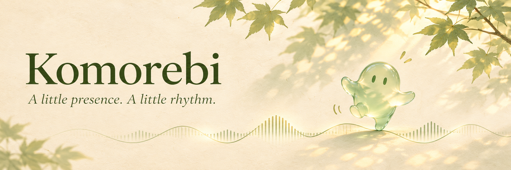
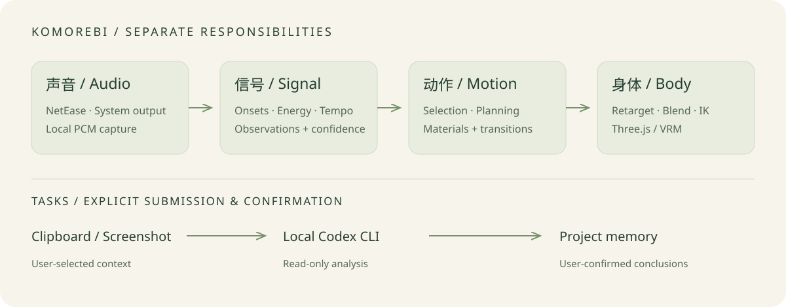

<p align="center"></p>
<p align="center"><strong>Komorebi · 木漏日</strong><br>A little presence. A little rhythm.</p>
<p align="center"><a href="README.md">简体中文</a> · English</p>
<p align="center"><a href="https://github.com/Chengyunlai/komorebi/actions/workflows/ci.yml"></a>  <a href="LICENSE"></a></p>

A lightweight desktop companion prototype. Keep a character beside your work, click to ask a question, and let it respond to music with movement and lyrics.

> Source prototype for macOS Apple Silicon. Full dance quality, long-running stability and public installers remain under evaluation. The cover is a brand illustration, not an app screenshot. Bring your own licensed VRM avatar.

## Features

- **Desktop presence:** a draggable, transparent, always-on-top VRM character with a compact conversation bubble and an on-demand management window.
- **Music response:** NetEase Cloud Music playback status and lyrics, plus local onset, energy and rhythm analysis from NetEase or system audio.
- **Quick tasks:** send clipboard text or screenshots to your local Codex CLI for read-only analysis; explicitly confirm conclusions before saving them to project memory.
- **Optional speech:** macOS speech or MiMo TTS with your own key, disabled by default.
- **Inspectable experiments:** synthetic audio benchmarks, BVH/VRM retargeting, phrase planning and layered replay, with runnable examples.

Music observations, motion decisions and body execution are separate. Onsets are not guaranteed beats; internal phrases are not detected choruses. Research integrations such as Bailando streaming require additional environments and licenses.

## Run from source

Requires **macOS and Node.js 22.13+**. Native music components also need Xcode Command Line Tools and CMake. System audio capture requires **macOS 14.2+** and system permission. Pure JavaScript tests and frontend builds can run elsewhere; desktop integrations have not been ported.

```sh
git clone https://github.com/Chengyunlai/komorebi.git
cd komorebi
npm ci
npm run setup:electron
npm run build:music
npm run build:audio
npm run build
npm start
```

Import a licensed `.vrm` through the tray or character context menu → management → preferences → avatar. No character models, research dances, model weights, music or real lyrics are bundled. Skip the two native `build:*` commands to try the character and task interface without music capture.

Task analysis needs an installed, authenticated standalone Codex CLI, or a user-configured Volcengine-compatible endpoint and key. Music and avatar display do not require an LLM key. See [usage and configuration](docs/usage.md) (Chinese).

## First steps

1. Open management from the tray or character context menu, import an avatar and select a project.
2. Click the character to open a conversation. `Option+Space` imports clipboard content; `Option+Shift+S` captures a selected screen area.
3. Submit a question and read the result in the bubble. Confirm “save conclusion” to add it to project memory.
4. Open the NetEase music panel or enable system audio response. `Option+Shift+H` toggles companion visibility.

Audio analysis stays local; experimental generation may write temporary WAV files locally. Submitted task context and screenshots go to the selected task backend. Track metadata goes to NetEase for lyric matching. Keys are stored using Electron safeStorage; see [data and permissions](docs/usage.md).

## Architecture



Vue and Three.js/three-vrm render the interface and avatar; Electron provides system access and local storage. The independent [music-signal-lab](electron/vendor/music-signal/provenance.json) supplies a vendored, versioned signal module. No neighboring checkout is required.

## Develop and contribute

```sh
npm run verify
npm run check:release
node examples/stage-33-music-baseline/user_code/main.mjs
```

Start with the [examples index](examples/README.md), run `user_code`, then inspect `core`. Read [CONTRIBUTING.md](CONTRIBUTING.md) and the [documentation map](docs/README.md). Most research notes are in Chinese; issues and PRs in either language are welcome.

CI runs tests and builds on Linux with Node 22/24 and compiles native components on macOS. The manual packaging workflow produces an ad-hoc-signed test artifact, with no automatic release. Production distribution still needs signing, notarization and device testing.

## Status

| Area | Status |
| --- | --- |
| Avatar, task bubble, project conclusions, music and lyrics | Implemented; overall daily-use validation remains open |
| Music/body benchmarks | Automated checks exist; real-song accuracy and dance quality require separate review |
| Phrase planning, motion libraries, streaming generation | Research implementations with external local assets/environments |
| Microphone, input events, sound classification | Planned |
| Windows/Linux desktop and notarized installers | Not provided |

Next priorities are continuous dance, reliable music response and everyday stability. See the [backlog](docs/project/BACKLOG.md) and [user-facing milestones](docs/project/MILESTONES.md).

## License

Original source is [MIT](LICENSE). The optional research adapter `scripts/bailando-stream-server.py` includes upstream sampling code and is separately covered by the [S-Lab non-commercial license](docs/licenses/Bailando-S-Lab-LICENSE.txt), outside the MIT scope. Third-party code, Live2D/Cubism, imported characters, motions, models and songs retain their own terms. MIT does not grant rights to those assets. Optional Live2D study resources are excluded; an original VRM idle fallback is included. See [THIRD-PARTY-NOTICES.md](THIRD-PARTY-NOTICES.md).
