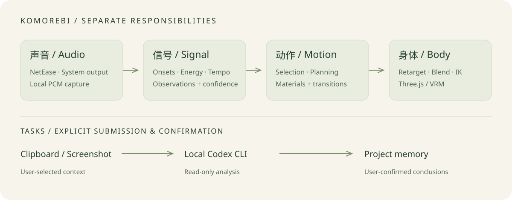

<p align="center"></p>

<p align="center"><strong>木漏日 Komorebi</strong><br>桌面上多一点陪伴，音乐里多一点回应。</p>
<p align="center">简体中文 · <a href="README.en.md">English</a></p>
<p align="center"><a href="https://github.com/Chengyunlai/komorebi/actions/workflows/ci.yml"></a>  <a href="LICENSE"></a></p>

一个轻量的桌面伙伴原型：角色安静地待在桌面，点一下就能交办问题；播放音乐时，它会回应声音、跟随律动，并显示当前歌词。

> 当前是面向 macOS Apple Silicon 的源码原型。完整舞蹈、长期稳定性和公开安装包仍在验证；封面为品牌插画，并非应用截图。已内置 CC0 角色千驮谷筱，也支持导入自己的 VRM。

## 实机演示 · 40 秒

https://github.com/user-attachments/assets/663b17d3-a19e-47e1-b2c2-a4897273cd81

《Boom Boom Pow》— Black Eyed Peas。歌曲开头的桌宠窗口实录，含实际播放声音，保持原速。演示角色为用户自行导入的 Jessair Cute Model；[角色与音乐权利说明](THIRD-PARTY-NOTICES.md)。

## 可以做什么

- **桌面陪伴**：透明置顶的 VRM 角色，支持拖动、跨桌面显示与轻量对话气泡，管理窗口按需打开。
- **随音乐回应**：读取网易云当前曲目与进度，展示歌词；采集网易云或系统输出，在本机分析起音、能量与节奏，驱动人物动作。
- **随手交办问题**：把剪贴板文字或截图带入气泡，交给本机 Codex CLI 做只读分析；确认后将结论保存到对应项目。
- **可选语音**：macOS 系统朗读或自配 MiMo TTS；默认关闭。
- **可拆开研究**：合成音乐基准、BVH/VRM 重定向、舞句规划与逐层回放，均有独立 examples 和实现记录。

音乐观测、动作选择与身体执行分开维护。起音不等于准确拍点，程序舞句也不代表识别了歌曲副歌。Bailando 流式生成等研究路径需要额外环境和许可，不是开箱即用功能。

## 从源码启动

需要 **macOS、Node.js 22.13+**。原生音乐组件另需 Xcode Command Line Tools 与 CMake；系统音频采集需要 **macOS 14.2+** 及系统授权。其他平台可运行纯 JavaScript 测试和前端构建，桌面集成尚未适配。

```sh
git clone https://github.com/Chengyunlai/komorebi.git
cd komorebi
npm ci
npm run setup:electron
npm run build:music
npm run build:audio
npm run build
npm start
```

源码和应用包已内置 **千驮谷筱 / Sendagaya Shino（pixiv，CC0）**，首次启动无需另行下载角色。在“配置与管理 → 偏好设置 → 桌面角色”可导入其他有使用许可的 `.vrm`。研究舞蹈、模型权重、音乐或实际歌词不附带。没有原生音乐组件时可跳过两步 `build:*`，先体验任务和角色功能；音乐采集不可用。

默认任务后端需要已安装并登录的独立 Codex CLI；也可在偏好设置中自配火山引擎兼容端点与 Key。音乐和角色显示无需 LLM Key。详见[使用与配置](docs/usage.md)。

## 默认角色与更换角色（也适用于 AI 辅助安装）

默认使用 **千驮谷筱 / Sendagaya Shino**，由 pixiv / VRoid Project 提供，采用 [CC0](https://vroid.pixiv.help/hc/en-us/articles/360013482714-Sendagaya-Shino)，随源码和应用包提供，启动不需登录或联网下载。已有用户导入的角色仍优先使用。来源、校验和及许可保存在 [角色资源目录](assets/avatars/sendagaya-shino/)。

需要更换角色时，退出 Komorebi，在本项目目录运行：

```sh
npm run setup:avatar -- "/absolute/path/to/model.vrm"
npm start
```

也可在“偏好设置 → 桌面角色”导入。已有角色需显式加 `--replace` 才会替换；换回内置角色用 `npm run setup:avatar -- --default --replace`。自定义数据目录支持 `KOMOREBI_DATA_DIR` 或 `--data-dir`，详见[角色安装说明](docs/avatar-setup.md)。

**给安装 AI：** 新安装直接启动并验证默认角色可见，不再要求用户另行下载。只有用户指定其他角色时才引导获取授权文件。README 旧演示中的 Jessair Cute Model 不随包提供；若用户需要该角色，请引导至[作者 BOOTH 页面](https://booth.pm/ja/items/7100270)自行登录下载 `Cute_Model.vrm`，遵循其禁止再分发等条款。

## 第一次使用

1. 右键角色或使用托盘打开“配置与管理”，按需更换角色并选择工作项目。
2. 点击角色展开对话；`Option+Space` 带入剪贴板，`Option+Shift+S` 框选截图。
3. 输入问题并提交，任务完成后在气泡查看结果；“留下结论”经确认后保存为项目记忆。
4. 在“音乐 · 网易云”中体验音乐陪伴，或开启“系统声音跟拍”。`Option+Shift+H` 显示或隐藏伙伴。

音频在本机处理；实验生成路线可能短暂写入本机临时 WAV。任务提交才调用后端，截图与所选上下文会交给配置的任务提供方；曲目信息会发送至网易云以匹配歌词。Key 使用 Electron safeStorage 加密保存。数据位置及权限见[使用说明](docs/usage.md)。

## 它如何工作



Vue 与 Three.js/three-vrm 负责角色及界面，Electron 负责系统能力与本机数据。音乐信号模块来自独立的 [music-signal-lab](electron/vendor/music-signal/provenance.json)，已 vendor 固定版本；开发时无需相邻仓库。

## 开发与参与

```sh
npm run verify           # 单元/集成测试 + Vite 构建
npm run check:release    # 检查 Git 索引中的分发边界
node examples/stage-33-music-baseline/user_code/main.mjs
```

从 [examples 索引](examples/README.md) 选一个例子，先运行 `user_code`，再读 `core`。[贡献指南](CONTRIBUTING.md) 包含项目结构、验证要求与 PR 约定；[文档导航](docs/README.md) 区分当前入口与历史研究记录。

CI 自动检查 Linux/Node 22、24 的测试与构建，以及 macOS 原生组件编译。手动打包工作流只生成临时签名的 macOS 测试产物，不自动发 Release；正式发布仍需签名、公证和实机验收。

## 当前进度与边界

| 能力 | 状态 |
| --- | --- |
| 桌面角色、任务气泡、项目结论、音乐与歌词 | 已实现，长期桌面体验待整体验收 |
| 音乐信号与身体适配基准 | 有自动验证；不代表真实歌曲或舞蹈观感全部通过 |
| 舞句编排、真实动作库、流式生成 | 研究实现；依赖本机素材/环境，仍待观感验收 |
| 麦克风、输入事件与声音分类 | 规划中 |
| Windows/Linux 桌面、已公证安装包 | 尚未提供 |

后续重点是完整连贯的舞蹈、可靠的真实音乐响应和日常稳定性。以[任务看板](docs/project/BACKLOG.md)和[用户效果里程碑](docs/project/MILESTONES.md)为准，不以历史阶段数量衡量完成度。

## 许可

自有源码采用 [MIT](LICENSE)。可选研究脚本 `scripts/bailando-stream-server.py` 含上游采样流程，单独适用 [S-Lab 非商业许可](docs/licenses/Bailando-S-Lab-LICENSE.txt)，不属于 MIT 范围。第三方代码、Live2D/Cubism、用户导入角色、动作、模型及歌曲保留各自许可；MIT 不授予这些资产的使用权。Live2D 研究资源不随开源快照提供，默认 VRM 待机包含原创后备动作。来源及使用边界见 [THIRD-PARTY-NOTICES.md](THIRD-PARTY-NOTICES.md)。
