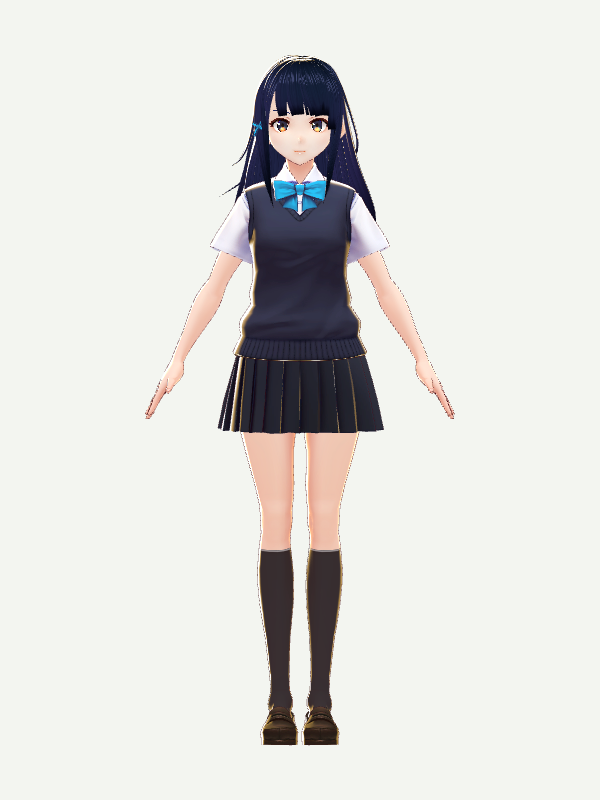
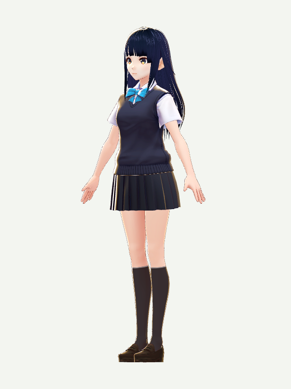

# Avatar references and resources

[Home](../README.en.md) · [中文](avatars.md) · [Import and restore guide](avatar-setup.md)

Komorebi includes **Sendagaya Shino** by pixiv / VRoid Project. A fresh install needs no separate avatar download. Existing user imports take priority.

## Included avatar

<table><tr>
<td align="center"><br>Front</td>
<td align="center"><br>Three-quarter</td>
</tr></table>

These are static renders of the bundled CC0 model, not app screenshots or dance demonstrations. See [image provenance](assets/README.md).

- **Creator:** pixiv Inc. / VRoid Project. An existing third-party character, not an original or exclusive Komorebi character.
- **License:** CC0 1.0, separate from the source code's MIT license; modification, commercial use and redistribution are permitted.
- **File:** VRM 0.x, about 15.1 MB. Display, idle motion and opening the task bubble were checked in the local macOS test package.
- **Sources:** [official character and license](https://vroid.pixiv.help/hc/en-us/articles/360013482714-Sendagaya-Shino), [official model and preview](https://hub.vroid.com/en/characters/5860098757548846785/models/6567311261748429976), [bundled asset and provenance](../assets/avatars/sendagaya-shino/).

## Alternatives

Only Shino is bundled and visually checked in Komorebi. These links are references, not compatibility guarantees. License details were checked on **2026-11-04** and apply to the linked versions.

| Character | Appearance and official source | Redistribution |
| --- | --- | --- |
| β AvatarSample_1 | Bob cut and P-shaped hairpin; [images and CC0 terms](https://vroid.pixiv.help/hc/en-us/articles/360012381793), [model](https://hub.vroid.com/en/characters/675572020956181239/models/4479743608263344465) | CC0; allowed |
| β AvatarSample_2 | Brown bob and green eyes; [images and CC0 terms](https://vroid.pixiv.help/hc/en-us/articles/360014900273), [model](https://hub.vroid.com/en/characters/945152946522067123/models/1622417912888236740) | CC0; allowed |
| Sakurada Fumiriya | Male, medium-length blonde hair; [CC0 terms](https://vroid.pixiv.help/hc/en-us/articles/360014788554-Sakurada-Fumiriya), [model and preview](https://hub.vroid.com/en/characters/6912965120285194650/models/2261505926203110716) | CC0; allowed |
| AvatarSample_A / B / C | Newer official samples; [A](https://hub.vroid.com/en/characters/2843975675147313744/models/5644550979324015604), [B](https://hub.vroid.com/en/characters/7939147878897061040/models/2292219474373673889), [C](https://hub.vroid.com/en/characters/1248981995540129234/models/8640547963669442173) | [Specific terms](https://vroid.pixiv.help/hc/en-us/articles/4402394424089), not CC0. Restrictions include paid redistribution of model files, character creation services and relabeling as CC0. |
| Jessair Cute Model | Blue-haired character in the older README video; [author's images, download and terms](https://booth.pm/ja/items/7100270) | Prohibited. Free personal/commercial use does not grant redistribution; BOOTH sign-in and separate download are needed. Credit Jessair and follow the author's other restrictions. |

## Find, create and import

[VRoid Hub](https://hub.vroid.com/en/) provides model previews and individual permissions. [BOOTH](https://booth.pm/) hosts creators' models and clothing. [VRoid Studio](https://vroid.com/en/studio) is a free character creation tool with VRM export. [VRM documentation](https://vrm.dev/en/vrm/) explains the format. Read the terms for each model and any third-party textures or clothing; free price does not mean redistribution is permitted.

Import a licensed `.vrm` in preferences, or quit the app and run from the project directory:

```sh
npm run setup:avatar -- "/absolute/path/to/model.vrm"
npm start
```

Existing imports require `--replace`. To return to Shino, preserve any wanted old file, quit the app and run `npm run setup:avatar -- --default --replace`, then restart.

`.vroid` is an editor project, not an importable avatar. The importer checks structure, full-body bones, no external resources and a 64 MB limit. Proportions, clothing, physics and expression quality still need visual review. See the [setup guide](avatar-setup.md) for data directories and troubleshooting, and [third-party notices](../THIRD-PARTY-NOTICES.md) for asset boundaries.
