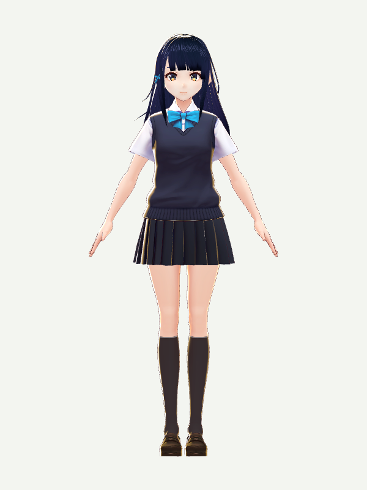
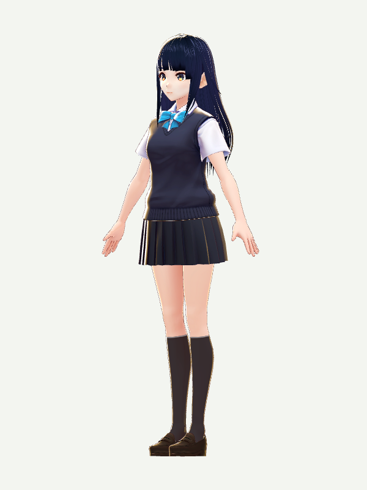

# 角色参考与资源导航

[项目首页](../README.md) · [使用与配置](usage.md) · [更换与恢复角色](avatar-setup.md) · [English](avatars.en.md)

刚开始使用，直接启动即可看到内置的**千驮谷筱**。想换外观，可以先看下方角色和来源，再按[导入步骤](avatar-setup.md)操作。

## 默认角色：千驮谷筱

<table>
<tr>
<td align="center"><br>正面</td>
<td align="center"><br>斜侧面</td>
</tr>
</table>

图片由本仓库内置 VRM 静态渲染，仅供外观参考；不是应用界面或舞蹈效果截图。角色由 pixiv / VRoid Project 提供，采用 CC0；[图片来源与生成说明](assets/README.md)。

| 项目 | 信息 |
| --- | --- |
| 名称 | 千驮谷筱 / Sendagaya Shino；官方日文名：千駄ヶ谷 篠 |
| 作者 | pixiv Inc. / VRoid Project；并非木漏日原创或独占角色 |
| 外观 | 深色长直发、蓝色领结、制服 |
| 当前提供方式 | 随源码和应用包内置，首次启动无需登录或下载 |
| 文件与兼容 | 当前内置文件为 VRM 0.x，约 15.1 MB；已在木漏日本机测试包中验证显示、待机和点击对话 |
| 许可 | CC0 1.0，允许修改、商业使用和再分发；与项目源码 MIT 许可分别保留 |
| 官方参考 | [角色介绍与许可](https://vroid.pixiv.help/hc/en-us/articles/360013482714-Sendagaya-Shino) · [官方模型页与交互预览](https://hub.vroid.com/en/characters/5860098757548846785/models/6567311261748429976) |
| 本项目资源 | [模型、许可与来源](../assets/avatars/sendagaya-shino/) · [精确版本与校验和](../assets/avatars/sendagaya-shino/provenance.json) |

换回内置角色，在项目目录执行以下命令；它会替换当前导入的角色，先保留需要的旧文件：

```sh
# 先退出 Komorebi
npm run setup:avatar -- --default --replace
npm start
```

## 还有哪些角色可以参考

以下是外观与许可参考目录，**不代表全部已在木漏日中验证**。除千驮谷筱外，其他模型均未随包提供；请从具体角色页面获取对应文件，下载后确认文件内的许可与作者当前说明一致。

| 角色 | 外观参考 | 获取与许可 | 随应用再分发 |
| --- | --- | --- | --- |
| **千驮谷筱 / Sendagaya Shino** | 长直发制服少女；见上图及[官方预览](https://hub.vroid.com/en/characters/5860098757548846785/models/6567311261748429976) | 已内置；[官方 CC0 说明](https://vroid.pixiv.help/hc/en-us/articles/360013482714-Sendagaya-Shino) | 允许，当前已附带 |
| **β AvatarSample_1** | 短发、P 形发夹；[官方图片与介绍](https://vroid.pixiv.help/hc/en-us/articles/360012381793) | [官方模型页](https://hub.vroid.com/en/characters/675572020956181239/models/4479743608263344465)；CC0 | 允许；本项目未附带、未实测 |
| **β AvatarSample_2** | 棕色短发、绿色眼睛；[官方图片与介绍](https://vroid.pixiv.help/hc/en-us/articles/360014900273) | [官方模型页](https://hub.vroid.com/en/characters/945152946522067123/models/1622417912888236740)；CC0 | 允许；本项目未附带、未实测 |
| **Sakurada Fumiriya** | 金色中长发男性；[官方介绍](https://vroid.pixiv.help/hc/en-us/articles/360014788554-Sakurada-Fumiriya) | [官方模型页与预览](https://hub.vroid.com/en/characters/6912965120285194650/models/2261505926203110716)；CC0 | 允许；本项目未附带、未实测 |
| **AvatarSample_A / B / C** | 较新的官方样例；[A](https://hub.vroid.com/en/characters/2843975675147313744/models/5644550979324015604) · [B](https://hub.vroid.com/en/characters/7939147878897061040/models/2292219474373673889) · [C](https://hub.vroid.com/en/characters/1248981995540129234/models/8640547963669442173) | [专用使用条款](https://vroid.pixiv.help/hc/en-us/articles/4402394424089)，**不是 CC0** | 有条件允许；不可改标 CC0、收费转售模型或用于角色创建服务，详见原条款 |
| **Jessair Cute Model** | README 旧视频中的蓝发角色；[作者图片、下载与条款](https://booth.pm/ja/items/7100270) | 免费，BOOTH 需登录下载；允许个人/商业使用，禁止再分发、转卖、NFT 和 AI 训练，使用或展示时请署名 Jessair | **禁止**；仅用户自行下载导入，未附带 |

许可和获取方式核对日期：**2026-11-04**。表中许可针对链接所指的具体版本，不自动涵盖同名改款、第三方服装或贴图。CC0 的复制、修改及分发范围见 [Creative Commons 官方说明](https://creativecommons.org/publicdomain/zero/1.0/deed.zh-hans)。

## 去哪里找、制作和了解角色

| 你的目的 | 入口 | 使用提示 |
| --- | --- | --- |
| 浏览人物与三维预览 | [VRoid Hub](https://hub.vroid.com/en/) | 查看每个模型的使用、商业、改造和再分发条件；下载可能需要 pixiv 登录 |
| 寻找作者发布的角色、服装 | [BOOTH](https://booth.pm/) | 先看作者条款与文件格式；“免费”本身不代表允许再分发 |
| 自己制作或调整角色 | [VRoid Studio 官方网站](https://vroid.com/en/studio) | 免费建模工具，可导出 VRM；使用第三方素材时仍需遵守其许可 |
| 了解 VRM 文件和生态 | [VRM 官方文档](https://vrm.dev/en/vrm/) | 日常角色入口接受 `.vrm`，不是 Live2D 或 `.vroid` 工程 |
| 给木漏日导入角色 | [安装与恢复说明](avatar-setup.md) | 图形界面、命令安装、自定义数据目录及 AI 安装约定 |
| 查看项目素材使用范围 | [第三方来源与许可](../THIRD-PARTY-NOTICES.md) | 角色、音乐、研究动作和源码分别保留其许可 |

## 导入前后常见问题

- **下载了 `.vroid`，为什么导不进去？** 它是编辑工程，需用 VRoid Studio 导出 `.vrm`；或者直接下载作者提供的 VRM 文件。
- **角色能导入，就一定能跳得一样好吗？** 还需观察身体比例、骨骼、裙摆、头发物理与表情。当前校验检查结构、全身骨骼、外部资源及 64 MB 大小限制，不能替代视觉验收。
- **升级后怎么还是旧角色？** 已导入文件优先于内置角色，这是保留用户选择；按上面的恢复命令可换回千驮谷筱。
- **新角色没有显示？** 命令安装后重启应用；图形界面导入会自动重载。确认安装命令和启动应用使用同一数据目录，细节见[角色安装](avatar-setup.md)。
- **可以把自己的模型发给别人吗？** 根据该模型及其服装、贴图等素材的具体许可判断；本机使用许可和再分发许可是两个不同条件。
