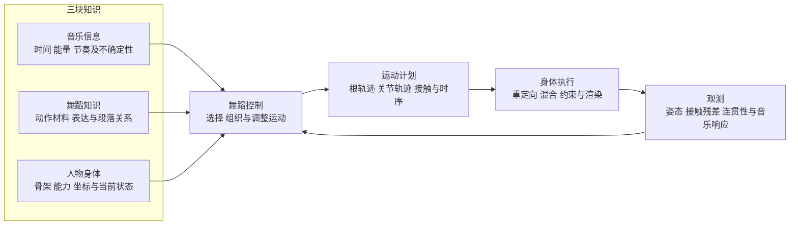

# 音乐信息 人物身体与舞蹈知识黑板

更新：2026-10-29。适用于 Komorebi 音乐桌宠主线；关联独立项目 music-signal-lab。

**目标：音乐信息、身体能力和舞蹈知识共同决定一段可执行且连贯的运动。** 每次实现先说明依赖哪块知识、改变哪层数据、用什么证据验证，再改运行效果。

这块黑板是项目研究与工程决策的共同入口。当前原型已经打通声音到人物的链路，但“角色动了”“时间对齐”“脚目标误差小”“舞蹈自然”是四种不同结果。三块知识之间的转换，是后续主线。

## 一张总图



图名：三块知识如何约束人物舞蹈｜图型：数据与反馈关系。

音乐输出的是观测；身体执行需要控制目标；舞蹈控制负责中间的转换。音乐强度本身既不是一个动作，也不能唯一决定某个关节角度。

| 黑板 | 它要回答的问题 | 输出给下游的内容 | 当前边界 |
| --- | --- | --- | --- |
| 音乐信息 | 声音中发生了什么，何时发生，有多可靠？ | 时间戳、能量、起音、节奏估计、置信度与失效状态 | 先保留当前能力；有明确下游需求再扩展 |
| 人物身体 | 人物能动哪里，输入什么数据才能正确地动？ | 骨架与坐标约定、可控能力、姿态与运动反馈 | 可动关节多，不等于已有协调运动能力 |
| 舞蹈知识 | 选择什么动作，怎样组织、变化和衔接？ | 动作材料、表达条件、段落关系与运动计划 | 教学概念、学习码本和最终控制量需要分别定义 |

## 黑板一 音乐转信息

### 已由当前代码确认的事实

独立库 [MusicAnalyzer](../../electron/vendor/music-signal/analyzer.mjs) 的 PCM 输入是连续采样位置和有限单声道浮点数。宿主使用的 [vendor 副本](../../electron/vendor/music-signal/analyzer.mjs) 当前与其一致；协议已有 [music-signal/v1](../../electron/vendor/music-signal/music-signal-v1.d.ts)。

| 信息 | 当前做法 | 能证明什么，不能证明什么 |
| --- | --- | --- |
| 能量与频段 | 10ms窗口；RMS、自适应归一化能量、一阶滤波频段 | 描述响弱及频段变化；不等于标准响度、乐器识别或情绪 |
| 起音 onset | 低频能量正增量、门限、最短240ms间隔 | 观察部分瞬态；不是完整频谱流检测，也不是每次起音都能检出 |
| 速度 tempo 与拍点 beat | 最近起音间隔中位数、稳定度与老化评分 | 估计节奏；可能半速、倍速或漏拍。confidence为启发式评分，不是校准概率 |
| 时间与状态 | streamId、seq、sampleFrame/sampleRate、warming/tracking/silent/lost | 能追溯采样时钟；10ms窗口不等于采集到画面的总延迟 |
| 强拍、小节、乐句与副歌 | 分析器未实现 | 动作内部每2/8拍的分组不能用作歌曲结构识别结果 |

宿主 Worker 目前只向渲染侧发送最新 features，独立 onset/beat 事件未逐条交付；下游通过 lastOnsetFrame 识别新起音。这适合连续强度，是否满足逐个重音消费，需要另行验证。featureHz默认30，但当前窗口调度量化后实际约25Hz。

### 需求如何反推音乐能力

| 舞蹈控制真正需要什么 | 音乐侧应提供或验证什么 | 暂时不推导的结论 |
| --- | --- | --- |
| 随整体强弱放大或收敛 | 能量及变化趋势、时间年龄 | 强度高不自动等于抬膝更高 |
| 对某个重音做身体强调 | 独立起音/重音事件及漏事件统计 | 不要求每个重音都落脚 |
| 在小节边界换舞句 | 可靠拍网格、拍号与小节边界；低可靠时明确未知 | 不用 beat % 4 冒充强拍检测 |
| 随歌曲段落变化编排 | 段落边界、重复关系和各自可靠度 | 声学分段不自动等于识别副歌 |

算法参考：[librosa beat_track](https://librosa.org/doc/main/api/generated/librosa.beat.beat_track.html) 把起音强度、速度估计和拍点选择分成不同步骤；[Essentia RhythmExtractor2013](https://essentia.upf.edu/reference/std_RhythmExtractor2013.html) 可作为拍跟踪候选对照，但需核对离线/流式条件、采样率和分数定义；[SBic](https://essentia.upf.edu/reference/std_SBic.html) 提供声学分段思路。这些尚未接入当前库。

## 黑板二 人物为什么能动

VRM人物每帧接受骨骼局部旋转与髋/根变换。父子骨骼变换向下传播，得到各关节的世界位置；蒙皮根据绑定姿态、骨骼索引和权重改变网格顶点，最后才得到人物画面。见 [Three.js SkinnedMesh](https://threejs.org/docs/pages/SkinnedMesh.html)。

```text
运动目标
  → 局部骨骼旋转四元数 + 根位置与朝向
  → 骨骼层级的正向运动学 FK
  → 蒙皮顶点
  → 渲染画面
```

“脚到某个位置”需要逆向运动学 IK 反求腿部姿态；求解结果仍要经过上面的链路。IK不自行理解承重、摩擦或编舞。弹簧骨提供头发、衣物等次级运动，也不负责主体舞蹈。

[three-vrm Humanoid](https://pixiv.github.io/three-vrm/docs/classes/three-vrm.VRMHumanoid.html) 区分 normalized/raw 骨骼、相对rest pose与绝对局部变换；这些不能混用。当前版本为 three-vrm 3.5.5、Three.js 0.186.1。官方在线文档支持原理核对，具体API行为仍以已安装版本为准。

| 当前身体链路事实 | 后续必须明确的知识 |
| --- | --- |
| [Character.vue](../../src/Character.vue) 写 normalized 骨骼四元数和髋位移，再叠加本地动作与足约束 | 哪层拥有最终姿态，混合与约束分别改写多少运动 |
| [重定向](../../src/motion-lab/vrm-retarget.mjs) 匹配13个骨段方向、骨盆朝向及腿长比例 | 骨段方向无法唯一恢复沿长轴的扭转；需要明确肩、手腕、足趾和完整根轨迹的保留策略 |
| [本地动作](../../src/motion/local-dance.mjs) 以15Hz预采样，再插值播放 | 要验证采样、重定向和插值分别造成了什么变化 |
| [接触修正](../../src/motion/contact-plant.mjs) 用源高度、脚踝锚点和有限髋下沉约束腿 | 当前参考面为初始脚踝高度；不是鞋底、真实地板或足底受力测量 |
| 当前有全身骨骼与动作控制量 | 尚缺统一的人物能力表、坐标契约和跨体型运动保真基线 |

Live2D是另一种身体实现：参数驱动作者预制的变形关系，不能直接接收一套VRM人形骨骼旋转。跨模型复用应发生在运动意图或适配层，不能默认底层参数通用。

## 黑板三 舞蹈知识如何成为机器表示

### 先区分描述、计划和执行

Laban Movement Analysis 可用 Body、Effort、Space、Shape 及时间段落关系描述动作；Motif 能记录组成、时长、重叠和动作准备/展开/延续。它提供描述与标注词汇，并没有给出可直接套到VRM上的关节解算器。见 [2019年原始研究](https://www.frontiersin.org/journals/psychology/articles/10.3389/fpsyg.2019.00572/full)。

据此，本项目采用下面的设计分层；“表达意图到控制参数”的具体映射仍需样例验证。

| 舞蹈知识 | 建议机器表示 | 转换后的工程对象 |
| --- | --- | --- |
| 动作材料与完整段落 | 来源、起止、准备/主体/恢复、重复与变形关系；长度不限于2/4/8拍 | 可追溯动作素材和编排结构 |
| 轻重、急缓、收放、方向与身体部位配合 | 标注或学习条件、强度包络、部位间时序关系 | 表达条件；不是直接把“轻”设成一个固定角度 |
| 舞步、停顿、上身强调与节奏关系 | 锚点及其类型、拍/半拍/跨拍对应、可信度 | 时间安排；不强制一拍一次落脚 |
| 支撑变化、滑步与腾空 | 根轨迹、姿态、接触区间；plant/slide/lift/flight/unknown及来源 | 接触计划；接触与真实承重分开 |
| 下一段如何进入 | 入/出姿态、速度、朝向、轨迹和接触条件 | 运动过渡与候选选择 |
| 角色如何完成 | 重定向后的根/关节目标、约束与反馈 | 人物执行数据 |

“所有舞蹈都可由一套唯一核心动作分解”保留为未成立假设。可从某种风格的基本动作建立词汇，但描述层词汇、模型学习的离散码与教师命名的舞步不应直接画等号。

### 论文和公开实现分别帮助哪一步

| 参考 | 已支持的机制 | 本项目应借鉴什么 |
| --- | --- | --- |
| [Bailando CVPR 2022](https://arxiv.org/abs/2203.13055) · [代码](https://github.com/lisiyao21/Bailando) | 从运动学习量化动作词汇，再按音乐组织序列 | 用动作表示连接音乐与全身运动；不能把码本当作唯一基础舞步 |
| [EDGE CVPR 2023](https://edge-dance.github.io/) · [代码](https://github.com/Stanford-TML/EDGE) | 音乐条件生成、补间、续接和接触一致性 | 接触需保留有意滑步，整体运动连续性不能靠全部锁脚实现 |
| [Motion Graphs](https://graphics.cs.wisc.edu/Papers/2002/KGP02/) | 原始运动和生成过渡共同组成图 | 把过渡作为独立对象；原始应用不等于已解决舞蹈编排 |
| [Motion Matching示例](https://github.com/orangeduck/Motion-Matching) | 根据运动状态和控制目标检索后继运动 | 舞蹈条件加入查询属于本项目待验证设计；已有示例主要是行走 |
| [AIST++官方格式](https://google.github.io/aistplusplus_dataset/download.html) | 配对舞蹈的姿态、尺度、根位移等数据 | 作为数据与实验格式候选；不能当作现成舞句或足底受力标签库 |

代码、数据、权重和角色授权分别核对。Motion Matching代码MIT不覆盖配套动作数据；当前本机BVH为研究素材。以上来源是机制参考，不构成将研究动作或模型直接随桌宠分发的授权。

## 三块黑板之间的契约

下面是设计职责，不代表已经新增了对应运行模块。

| 对象 | 谁提供 | 最少应包含 | 谁消费 |
| --- | --- | --- | --- |
| MusicObservation | 独立音乐分析 | 采样时间、来源/epoch、特征、事件、置信度与未知状态 | 舞蹈控制 |
| BodyProfile / BodyState | 人物适配与执行 | 骨架、rest pose、坐标/单位、可控能力、当前姿态/根运动与反馈 | 舞蹈控制、重定向、约束 |
| MotionMaterial | 素材、人工标注或模型 | 根/关节轨迹、来源、时序锚点、动作上下文与接触语义 | 舞蹈控制、运动过渡 |
| DancePlan | 舞蹈控制 | 选什么、如何重复/变化、节奏关系、下一段及约束 | 运动生成/检索与身体适配 |
| PoseTarget / ExecutionReport | 身体适配与执行 | 每帧根变换、关节局部四元数、接触目标；实际改写与残差 | 渲染、回放与反馈 |

坐标契约必须声明单位、轴向、左右手、局部/世界空间、四元数顺序、rest相对/绝对以及根运动策略。相位必须注明“音乐相位、动作相位还是步态相位”；未知值保持未知。

## 当前假设账本

| 编号 | 当前假设或未知 | 现有依据 | 工程上怎样处理 |
| --- | --- | --- | --- |
| H1 | 一次落脚对应一拍 | stage-13两拍交替步试验 | 仅适用于该实验；素材标注允许上身重音、停顿和跨拍 |
| H2 | 首尾同一接触脚就适合衔接 | 当前转移允许条件，另以姿态代价排序 | 增加根朝向/速度及整体运动过渡验证 |
| H3 | 只保留骨段方向足以保真重定向 | stage-15纯twist反例证明方向不足；已新增校准旋转对照 | 继续检查真实蒙皮与完整段落；校准残差不替代观感 |
| H4 | 近零脚目标残差代表舞蹈自然 | 已被实际观感否定 | 接触目标、音乐响应、运动保真与段落连贯分别验收 |
| H5 | 音乐仍缺少某个更强算法 | 真实歌曲基准尚不足 | 先由具体控制需求和标注对照决定，不立即换DSP或模型 |

## 工程入口

[工程问题与实现顺序](music-dance-engineering.md) 给每项任务规定输入、产物、依赖和验收。现有stage-01至13保留为历史实现与实验；本黑板是后续音乐舞蹈主线的统一研究入口。

维护规则：每次新证据更新对应事实或假设；每次算法改动注明它消费/输出哪类数据；时间、接触或渲染指标不得替代完整舞蹈的观感验收。

身体保真进展：[stage-15](../implementation/stage-15-rotation-retarget.md)新增首帧校准后的完整旋转变化对照；日常仍为方向基线。

## Stage26 主验收调整

当前三个两拍片段的调度无法代表完整舞蹈编排。用户观感仍明显不足；低IK误差和根速度下降不算舞蹈完成。下一优先级是同一VRM完整连续源舞段的视觉基准，对照“源表演本身 / 身体重定向 / 切段编排”三种缺口，再做整舞句音乐同步。根呈现研究见stage-26-root-presentation.md，保留为底层实验，不替代主验收。

## DANCE-01 结论（stage-28）

完整连续源舞段（63 秒，dance-short.bvh）回放到同一 VRM 的观感已由用户人工确认合格；全段三条件数值证据（方向基线残差 102.9°、足约束改写 61.5°、角速率 p95≈266–290°/s）表明重定向/约束层存在可优化项但非当前主瓶颈。**失效归属：编排层**——`createBeatMotionBank` 仅从完整编译帧保留 3 个两拍片段（maxClips=3），切段破坏连续表达。下一步 DANCE-02 保留完整表达后再切片并做结构标注；stage-23 日常执行在完整舞段上的回放仍待验证（BODY-01 遗留）。
