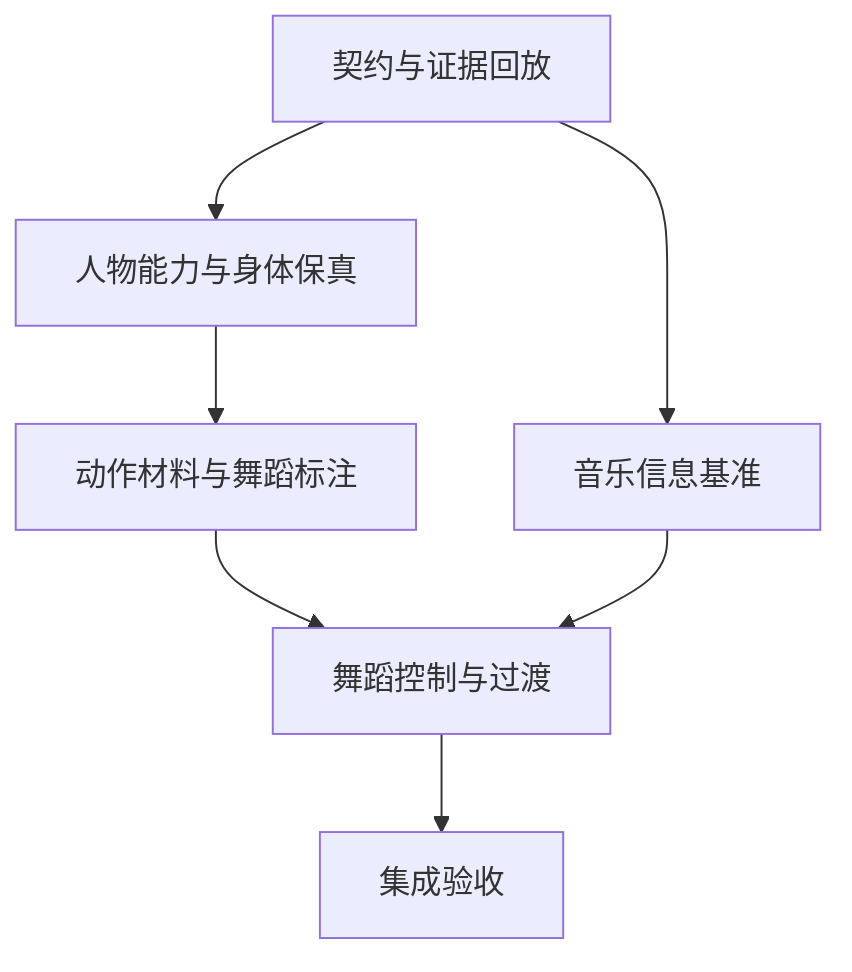

# 音乐舞蹈黑板对应的工程问题

依据：[三块黑板](music-dance-blackboard.md)。更新：2026-10-29。

目标是建立可复用的音乐到运动控制系统。当前阶段先补信息契约、统一运动表示和可归因实验，再选择控制算法。下表定义任务边界，阶段完成情况见文末；局部基线通过不等于整体任务完成。

## 实现依赖



图名：黑板知识转换为工程任务的依赖｜图型：实施依赖图。

音乐基准与身体基线可以并行。只有控制目标确实依赖未提供的音乐信息，才扩展信号项目。完整动作回放是隔离身体层的实验，不预设它就是最终交互或所有舞蹈都必须8拍。

## 可评审任务

| 编号与任务 | 对应黑板问题 | 交付物与依赖 | 怎样验收 |
| --- | --- | --- | --- |
| E0 契约与证据回放 | 三层数据能否在同一时间轴追溯？ | 复用music-signal/v1；定义BodyProfile、MotionMaterial、PoseTarget语义；记录原始观测、计划、重定向、混合和约束后的状态 | 同输入回放得到同输出；可单独切换音乐、重定向和约束实验；来源、时钟与改写层可定位，不凭截图猜原因 |
| E1 人物能力和坐标 | 什么数据能让目标人物正确动？ | 骨/层级/rest、单位/轴向、归一化与原始骨架关系；关节范围与脚底偏移未知时明确标记 | 静止、单关节、根位移/转向分项检查；至少两种比例或rest姿态验证；缺少可选骨时降级 |
| E2 统一运动表示与身体保真 | 动作从源到人物丢掉了什么？ | 保存根位置/朝向、局部关节旋转、必要速度和时间；明确保留/去除场景位移策略；依赖E0/E1 | 同段源运动与目标人物对照；比较方向、扭转、根轨迹和连续性；再看蒙皮画面，不能只比关节端点 |
| E3 舞蹈材料与标注 | 什么构成动作材料、表达及段落？ | 少量经检查的完整运动材料；准备/主体/恢复、方向、接触类型与多种节奏锚点；区分人工、自动和学习标签 | 相同材料可复用、重复、变形且来源可追溯；覆盖停顿/滑步/转身；允许非周期、不等长和一拍不落脚 |
| E4 舞蹈控制和运动过渡 | 音乐和身体状态怎样共同决定下一段？ | 先建立检索/规划基线：DancePlan → 后继检索 → 朝向/根轨迹处理 → 时间调整 → 姿态目标；依赖E2/E3 | 调整音乐条件而保持人物/素材不变，检查可解释响应；调整人物而保持计划不变，检查适配；过渡验证准备、速度和接触，非仅姿态接近 |
| M1 音乐信息基准与按需增强 | 哪类声音信息真能被控制器可靠消费？ | 合成对照与小规模有标注歌曲；起音/拍点/tempo分别评分，观测总延迟、漂移与事件丢失 | 报告真实歌曲漏检/误检及半/倍速；seek/换流/缺口隔离；不足再评估librosa、Essentia等候选，离线与实时条件分别比较 |
| E5 集成与观感验收 | 整体效果是否成为连贯且回应音乐的舞蹈？ | 固定素材/人物/音乐的对照矩阵与完整片段视频；依赖E4/M1 | 音乐可靠性、身体保真、可执行性、舞蹈表达四项分别通过；连续观察完整段落，记录具体失效场景和审阅意见 |

## 最先落地 E0 与 E1 E2 基线

已有研究窗口、原始BVH、VRM和音频信号可以复用。第一轮工程样例应回答一条连续问题链：

```text
一段可检查的源运动
  → 身体能力与坐标声明
  → 不受音乐影响的基准执行
  → 对照源运动、重定向、混合、约束各阶段
  → 加入同一份已记录音乐信息
  → 对比控制器改变了什么
```

建议唯一example路径：`examples/stage-14-dance-blackboard/`，继续保留core/与user_code/。该路径已在stage-14实现首版统一记录与身体回放基线。后续实现时让user_code只组装公开职责，核心算法留在所属模块。

候选断点：音乐观测的sampleFrame/age；运动材料的sourceTime/root/local rotations；舞蹈计划的素材及节奏锚点；执行前后每骨骼变化和接触残差。单个最终四元数必须能追溯由哪层产生或改写。

验收输出应同时包含同钟数据和实际人物画面。精确时钟或近零IK残差不能单独作为E5通过依据。尚未建立真实歌曲与跨模型基准时，保留该缺口，不把合成鼓点结果外推。

实时听歌只能使用已到达音频和有限预测。若引入前瞻缓冲，应明确增加的声画延迟；需要未来整段音乐的离线生成方法须单独评估，不能与因果流式基线混用验收。

## 算法路线的决策条件

- 检索/动作图基线能满足片段规模与延迟时，先用现有材料验证完整控制链。
- 需要超出素材库的运动组合或生成时，再以Bailando/EDGE等离线研究作对照；先核对训练数据、运行资源和输出重定向，不能把研究代码直接当桌宠实时插件。
- 需要风格、力度、收放等语义控制时，先定义标注和对照样例，再决定规则、参数化动作、检索条件或学习模型。Laban描述可帮助建立词汇，具体数值映射是待验证设计。
- 有意滑步、腾空和转身应由运动计划表达；执行约束要尊重这些语义。约束修正过大时反馈给控制与素材适配，而不是持续掩盖上游失真。

## 完成状态

本轮完成了三块知识的汇合、证据与假设分离、工程问题及依赖定义。stage-14已实现E0首版记录与确定性回放、E1能力声明及E2的根运动/分层对照。E0音乐时钟融合、E1跨真实模型、E2完整旋转与蒙皮质量、E3–E5及M1仍待补齐。现有stage-13继续运行，后续主线按本文件更新，不继续以单个动作参数作为任务边界。

当前工程交付：[stage-14实现与证据](../implementation/stage-14-dance-blackboard.md)。

E2补充：[stage-15](../implementation/stage-15-rotation-retarget.md)已实现首帧校准旋转变化保真对照和纯twist反例；跨真实模型、完整蒙皮及舞句质量仍待验收，未自动切换日常映射。

E2/E5可观测性补充：[stage-16](../implementation/stage-16-sequence-assessment.md)完成连续源区间三条件聚合、源帧索引修复及原生图像序列。足约束有显著改写，未宣称舞蹈观感或真实歌曲同步通过；下一阶段按E3/E4建立完整源材料与一致接触计划。

E3/E4首版见[stage-17](../implementation/stage-17-source-material.md)：完整源动作材料与双侧移动窗口过渡。材料独立于VRM，保留源层级和有向速度，不把未知接触/阶段/原曲节拍填成事实。数值模块和example通过后仍需不同动作的根朝向对齐、接触标注、实际人物研究回放；尚未替换stage-13日常控制器。

E3→E2执行桥见[stage-18](../implementation/stage-18-material-execution.md)：源材料局部姿态按层级FK后直接传入方向/旋转适配器`applyFrame`，原始`apply(time)`共用执行逻辑并保留基线。研究预览用于观察移动过渡，未因此验收音乐编排、接触约束或不同后继兼容。

E4空间一致性首版见[stage-19](../implementation/stage-19-planar-alignment.md)：交接起点髋部XZ/朝向决定固定水平刚体变换，作用整个入段且不改Y；固定/倾斜地面镜头用于对照。该操作只消除场景位置差，不能代替速度、接触、支撑和后继匹配；这些约束仍待补齐。

E3/E4后继评估见[stage-20](../implementation/stage-20-successor-assessment.md)：源足部运动学估计与显式标注分开，有向速度/姿态/高度的边界门槛及可解释候选排序；缺少可信接触只能review。日常控制、完整窗口/接触可执行性和音乐条件仍未验收。

E2/E4/E5完整脚部归因见[stage-21](../implementation/stage-21-foot-window-assessment.md)：共享源序列、混合期未知接触、源/目标踝路径/有向旋转增量差与证据分组。脚底偏移与接触未知，不能将位置差直接称为脚滑或自动启用plant约束。

E2端点轨迹执行首版见[stage-22](../implementation/stage-22-source-ankle-tracking.md)：已知源踝位移→目标锚点与尺度→双骨腿跟随，保留足部世界朝向、报告可达域投影和原目标残差。不依赖未知接触锁脚，骨盆参考点适配单独报告；旋转改写和真实观感仍需独立比较。

E5首轮日常整合见[stage-23](../implementation/stage-23-daily-music-execution.md)：身体Y-up和源踝目标进入实际Character，旧contact plant不再叠加；原创PCM实际分析验证激活、变速、静音和恢复。三段两拍编排及旋转/根独立限速仍有一致性缺口，局部回放毫米结果不能外推日常链路。

E4/E5分层归因见[stage-24](../implementation/stage-24-limiter-attribution.md)：独立过滤扩大FK不一致，一致过滤又产生显著目标滞后；运动预备段/朝向对齐降低旋转峰值但保留根动态取舍，默认未切换。下一个可归因问题是原始BVH根运动与当前in-place呈现根策略的分离，不能把已处理样本叫原舞者真值。

Stage25：[根轨迹与原地化归因](../implementation/stage-25-root-recentring.md)，离线源窗口证据表明瞬时减双踝中心会增加根动态；未修改日常默认，尚待实际目标链路及视觉对照。
