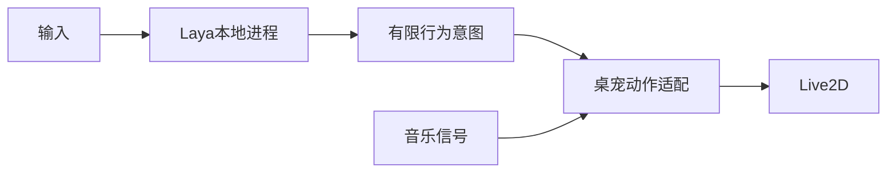

# Laya 行为意图试用

目标：音乐信号项目保持独立；桌宠按需运行本地 Laya 多语言模型，将中文指令分类为轻柔舞动、活泼舞动、停止或其他。低置信度不改变动作，不用规则伪装模型结果。只在用户提交行为指令时推理，不参与每帧计算。

Example：`examples/stage-01-laya/user_code/main.cjs`。入口 `BehaviorDirector.decide`；关键断点 Python `predict`、JS 答案校验、Character 帧处理。验证中文真实推理、无关任务不执行、错误不改变状态、暂停收势、构建和现有测试。

当前为本地未提交工作树，无 Git 基线。图为 Mermaid，未涉及 draw.io。

## 实测

环境 Python 3.13 / Laya 0.4.16 / Apple Silicon CPU；模型 revision 固定为 7b928d828b7b0e022f929d9bd2e44165aa270148，约 644MB 权重。依赖见 ../laya-runtime-requirements.txt。
最初冗长描述导致轻柔和活泼低置信度；保留 0.75 门槛，比较简短中文和英文选项后选用后者。
四条真实结果见 ../evidence/laya-decisions.jsonl：轻轻跳 gentle 0.8854、活泼一点 energetic 0.9627、停止跳舞 stop 0.978、代码解释 other 0.5411 不执行。首次加载 5537ms，后续 53–63ms。探索比较见 ../evidence/laya-prompt-comparison.jsonl；复杂否定和实现提问存在低置信度拒绝，这些少量样例不能证明通用中文准确率。0.75 是试用门槛，并非领域校准结论。
构建通过，28 项测试通过。已验证面板实际显示输入、判断中和低置信度不执行状态。动作端仅做有界幅度及 250ms 收势，不声称已有完整舞蹈动作库。工作树未提交。

实际应用联调发现预加载事件白名单遗漏 behavior，已修复并新增桥接行为测试，确保模型结果广播到人物和面板。

最终打包应用已验证：面板广播更新为活泼舞动（96%，首次5946ms），随后停止舞动（98%，188ms）；原创试跳的实际 Core 参数与收势数值见 evidence/laya-energetic-motion.json 和 laya-stop-motion.json。仅验证链路和数值，不等于舞蹈审美验收。

## 可感知效果修订

用户反馈无效果后确认旧版存在入口割裂：普通任务气泡不调用 Laya，且命令只缩放已有音乐动作，没有音乐时不动。现在普通气泡的短舞动指令也进入模型；附件和上下文任务保持任务路径，模型不接受的输入继续交给任务后端。明确舞动意图可在无音乐时使用默认节奏启动；全局舞动关闭和系统减少动态效果仍优先。
轻柔采用缓慢双臂协同，活泼采用交替手臂、点头和躯干转动，并以 120ms 平滑切换。停止释放音乐动作后仍保留角色原有 Idle。音频信号项目未修改。29 项测试、构建通过。

无音乐复测：网易云暂停、未开启试跳或跟拍，普通气泡输入活泼一点，显示“活泼舞动 · Laya”。人物报告 energetic，strength 稳定0.38，连续28帧的真实 Core 参数记录在 evidence/laya-without-music-motion.json。临时关闭失焦收起仅用于自动化测试，已通过界面恢复为 on。当前桌宠保持活泼舞动，便于观察。
