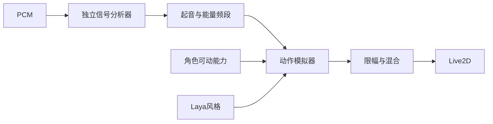

# 音乐信号到动作片段

目标：消除固定正弦摇摆冒充随音乐舞动的问题。真实音频模式下只由新的音频起音触发短动作；能量决定力度，频段决定躯干、单臂、双臂片段，片段可叠加、限幅并平滑混合。Laya 只调幅，不覆盖音频动作。断流和静音收势，绝不回退到固定摇摆。无音频时明确标识为动作试跳。

使用 example：examples/stage-02-audio-motion/user_code/main.mjs。断点：MusicMotionSimulator.schedule（起音去重与片段选择）、step（音频时钟、分层混合）、Character.updateNaturalMovements（音乐模式优先于试跳）。验证：同 BPM 不同起音/频段给出不同轨迹；重复包不重复触发；静音/断流/换流不伪造舞动；实际原创 PCM 分析闭环。
当前工作树未提交；沿用现有本地模型和音频授权，不上传音频。

## 验证结果

- 32项测试通过；包括同BPM不同起音/频段改变轨迹、重复包去重、断流及静音收势、换流不重播陈旧起音、缺少手臂能力时跳过通道。
- 24秒原创PCM → 独立分析器 → 模拟器的可运行 example 已完成，记录在 ../evidence/audio-motion-pcm.jsonl。
- 实际网易云输入已验证：netease-1-2，采样记录中起音触发计数从13增至89，组合 alternate-reach 和 open-arms。真实Core参数与模式见 ../evidence/audio-motion-netease.json，rootAngle始终0，排除窗口旋转假摇摆。
- 已用原生界面确认真实音频非零并查看人物画面；人物的可动范围仍有限，当前模型无独立膝腿脚参数。技术链路验证不等于全身舞蹈审美或精确节拍延迟验收。
- 当前起音检测基于已有低频分析，无法保证任意歌曲的鼓点/强拍准确率；band策略是规则组合，没有训练舞蹈生成模型。
- Laya风格不会覆盖真实音频轨迹。明示无音乐试跳才使用固定动作。未提交；无需修改或推送独立信号仓库。
