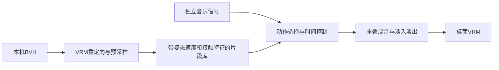

# Stage 12：本地真实舞蹈动作库

目标：把本机研究BVH接入音乐主线。音乐分析仍独立；桌宠维护动作库和调度。
计划：离线式预采样VRM姿态 → 多个连续片段 → 姿态/速度/足接触匹配选择 → 重叠过渡 → 音乐控制播放速度及片段活跃度。

Example：examples/stage-12-motion-bank/user_code/main.mjs。
公开路径：createMotionBank(frames) → MotionBankPlayer.step({dt,active,bpm,energy})。
断点：createMotionBank 的片段特征、MotionBankPlayer.choose 的候选代价、step 的过渡时间和播放权重。
验收：实际本地BVH构库；连续运行无NaN；动作变化；断流停止；构建和既有测试。
限制：这是研究动作驱动的首版，不是Bailando训练模型，也不是完整Motion Matching。接触估计用于选择，不提供物理求解；BVH研究授权CC BY-NC 4.0，仅本机使用，不分发源或派生姿态。基准100 BPM是时间缩放参考，不声称识别了参考舞蹈原始节拍。当前重定向仍为方向映射，未恢复完整骨骼扭转。
当前未提交；未创建远程issue。

## 验证

- `npm test`：62/62通过。
- `node examples/stage-12-motion-bank/user_code/main.mjs`：本机63秒参考生成950帧、12段；模拟120秒发生26次选择，停止权重归零。输出见docs/evidence/motion-bank-summary.json。这是代理骨架调度验证，不是完整VRM脚底误差测量。
- 每骨骼输出角速度限制7 rad/s，避免原始重定向异常瞬变；位移限速0.4m/s。重叠混合0.5秒，音乐结束0.35秒淡出。
- 原生Electron隔离数据目录试运行：实际Cute Model载入12段；无音频明确预览从片段0进入片段2，权重1。截图确认模型全身可见且包含提腿、伸臂和身体转向。
- 原生回放没有启用旧程序足目标IK，避免与真实动作互相争夺腿部。接触约束只参与选择，不宣称已解决滑步。

未直接采用训练模型；未识别舞蹈节拍边界；不保证每对片段均有可行承重过渡。后续优先人工标注接触边界、根运动和参考节拍，再替换固定时长分片。没有本机研究数据时继续原创程序舞句。

原生原创PCM试跳验证：READY时12段、权重0；启动musicAudioStart('demo')后片段2、权重1；musicAudioStop后权重0。见docs/evidence/motion-bank-native-audio.txt。未在本轮复测网易云系统采集权限或真实歌曲的对拍精度。
