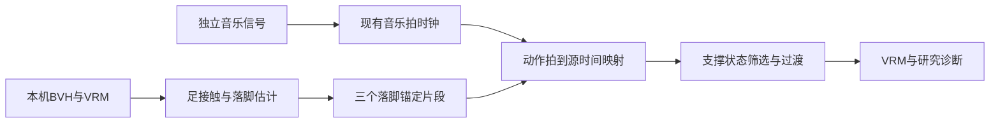

# Stage 13：动作落脚与音乐拍点对齐

目标：选三个带落脚锚点的研究动作，使用现有音乐拍时钟推进；优先兼容支撑状态的过渡，展示音乐拍/动作拍/支撑脚诊断。

边界：接触与源拍点是自动估计，未知接触不伪装双脚支撑；音频起音不是可靠强拍，沿用tracking/estimated区别。首轮先做到控制拍域对齐，不宣称听觉重拍识别和物理承重已解决。派生研究数据仅内存，不分发。
Example：examples/stage-13-beat-steps/user_code/main.mjs；短路径 prepareLocalDance → createMotionBank → MotionBankPlayer.step({beat,bpm,timing,active})。
断点：片段锚点/支撑状态、播放器相位映射/候选转移、Character诊断。
验证：合成稳定鼓点90/120/150 BPM各30秒；相位偏移/变速/断流；真实BVH构库及原生原创PCM闭环，截图/日志。
当前本地工作目录无Git基线，未提交，不新建外部issue。

## 实现与取舍

已从源脚轨迹自动提取三段R-L-R两拍短句（每次根据具体VRM与源轨迹重新选择，15 Hz采样；具体范围见运行证据）；去掉前9秒静态参考。每个源落脚映射为一个整数音乐拍，此为可验证的首轮编排假设，非对原舞蹈音乐节拍的人工标定。

音乐播放使用同一个连续beat，不再在片段播放器独立按bpm/100积分；首次播放/换流等待下个整数拍，可靠起音相位以最多±.18拍/秒修正，不跳相位、不倒退。每两拍在接触脚兼容的候选间选择，最后.3拍准备下一段；无兼容后继则重用当前句，不强切未知支撑。

源脚世界轨迹用于估计接触，而非删去场景移动后的目标脚速度。稳定确认后回溯到25mm高度阈值跨越作为可见落脚锚点；抬脚证据不足或数据缺失不跨越推断。方向重定向保留髋部相对双脚中点的平衡移动。脚踝锚定加入最多10cm髋下沉，并区分成功/跳过/不可达，不能将locked计数解释为力学承重。

诊断源帧量化误差单位为秒，仅反映时间映射精度，不含输出混合、角速度限制后的实际落脚滞后。新增脚踝高度和几何落脚偏拍观测；仍未测足底受力、鞋底碰撞、听觉延迟。

## 验证结果

- `npm test`：81/81通过，含源高度重定向、地面下穿纠正、不可达拒绝、稳定PCM端到端和换流时钟。
- `node examples/stage-13-beat-steps/user_code/main.mjs`：90/120/150 BPM各30秒；12秒后全部稳定跟踪，时钟相对已知原创鼓点的最大相位偏差17.51/10.05/10.04ms。该数值仅为时钟，不是最终画面脚底精度。代理骨架选片可能与具体VRM不同，不要求稳定音乐强制遍历全部片段。
- 原生Cute Model + 原创24秒PCM：三段库可用，14–16秒静音收势、随后恢复，24秒后停止；Renderer错误0。
- 原生高度修正前，实际可见落脚估计可提前约.475拍，脚踝可低于参考面8.9cm；修正后采样落脚偏拍范围-.1383～+.0833拍，最小脚高约-5.55e-17m（浮点误差）。已锁定脚目标残差近浮点误差。不把近零残差解释为受力承重或所有时刻精确踩拍。
- 动作解剖只读诊断页面的IPC权限已实测修复；它仍不能访问任务、凭据与项目资料。

原生采样是每秒快照与高度阈值落脚估计，不是逐帧动作捕捉验收；未在本轮复测网易云任意歌曲对拍。普通歌曲的节拍估计仍可能半拍/倍拍或失锁。
