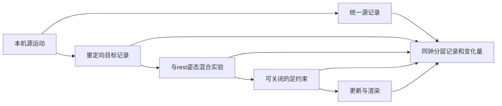

# Stage 14 统一运动记录与身体回放基线

对应黑板E0及E1/E2的第一版基线。目标：同一源时间可追溯source → retarget → blend → constrained → final，分离音乐观测与身体执行。

图名：统一运动记录与身体回放基线｜图型：执行数据流。

Example：examples/stage-14-dance-blackboard/user_code/main.mjs。公开路径createReplayExperiment(vrm,bvh) → evaluate({time,rootMode,blendWeight,constraints,physics,music})。预期：同输入回放相同，根运动策略可区别，每层可比；任意seek固定步长重建约束历史。
断点：createBodyProfile/capturePoseRecord；重定向apply；evaluate推进与阶段捕获；comparePoseRecords。
验收：两种合成骨架与非恒等rest、回放幂等、坏数据不部分修改；本机BVH与实际VRM原生同钟对照、设置切换及重复seek一致；研究窗不写入桌宠控制。

范围：E0第一版协议与基准执行；E1能力声明；E2保留根运动策略和分层比较。混合实验明确为原运动与目标rest混合，不伪装成现行两拍拼接器；音乐观测可以附入记录，但本实验不新增音乐驱动编排。舞蹈语义、完整twist重定向、跨真实模型质量与真实歌曲基准仍待后续。
研究数据与派生姿态只本机内存，不随app或源码分发。无Git基线，未提交。

## 完成与证据

- 新增BodyProfile/motion-record/v1/source记录；目标记录严格声明normalized-local-absolute，按整批校验后应用。源rig坐标不能直接写到目标rig。关节限制/脚底偏移未知，bodyId仅是绑定标签，跨体型仍须重定向。
- 新研究入口：动作解剖 → 分层回放。默认无物理、无足约束、rest混合权重1；选层、根策略、慢放、逐帧、当前JSON与各层改写量可查看。
- 根策略height/source/balance；发现原转换把首帧身体倾斜带入世界平移，改为根平面运动仅yaw映射，保持Y-up。该修正也应用到现行balance模式，未改音乐分析与舞蹈选择。
- 回放使用源frameTime固定步推进；选项变化/倒退从起点重建，物理启用的同帧请求也重建，避免上次显示层污染物理历史。长定位约0.3秒量级（本机13.2秒定位），未加检查点加速。
- `npm test`：90/90通过。覆盖不同骨长与非恒等rest、原子拒绝、重复回放、源FK重建、根Y-up隔离及原有行为。
- 两条example均真实运行：原创合成骨架、合成骨架+本机研究BVH，重复定位记录一致。真实VRM由原生独立userData验证，不能将合成模型结果当真实蒙皮验收。
- 原生实际角色：7项断言通过；13.2→1→13.2全trace严格相等；根策略、混合权重和足约束分别产生预期记录变化；source与height根Y一致，镜头跟随时人物完整可见，无renderer错误。见docs/evidence/replay-native.json与replay-native.png。
- 完整本机研究trace不随源码分发；仓库证据只保留汇总、断言和截图。显示的骨段方向误差不衡量twist、蒙皮或舞蹈自然性。阶段对比是改写量而非质量分数。

音乐已可附入trace并声明各自采样时钟，relationship明确unmapped，未假装实现音乐/动作时钟融合。E0为首版身体回放基线，E1跨真实模型、E2完整旋转保真、E3舞蹈语义及E4编排还需后续。日常人物的舞蹈自然度尚未由本阶段证明。
