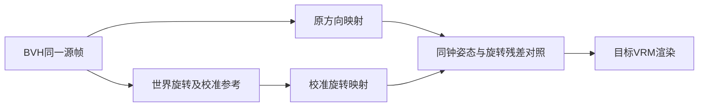

# Stage 15 源旋转保真对照

黑板E2：检查源动作骨段方向之外的旋转信息，建立可切换的校准旋转映射。
目标：纯绕骨长轴的旋转不改变端点方向，但应改变目标关节朝向；手腕、肩带、头和足趾的旋转变化可追踪。
校准假设：以源首帧及方向匹配后的目标首帧建立每骨参考，传递此后的世界旋转变化。不能声称恢复了首帧未知的绝对扭转。

Example：examples/stage-15-rotation-retarget/user_code/main.mjs。计划API：createReplayExperiment.evaluate({retargetMode:'direction'|'rotation',...})。基线默认direction，日常动作不自动启用rotation。
验证：原创纯扭转与手腕fixture、首帧校准一致、不同骨长/非恒等rest、根Y-up、重复seek；实际本机VRM同帧对照截图与残差，质量结论不由数值残差单独替代。
待实现/验证期间无Git提交。不分发源BVH、角色或派生姿态。

## 实现与校准

新模块rotation-retarget.mjs在首帧建立源旋转S(0)、方向匹配后的目标世界姿态B(0)和固定坐标转换C。随后：`T(t)=C·S(t)·inverse(S(0))·inverse(C)·B(0)`。按实际目标骨父子顺序转换回局部旋转，保留完整源旋转变化。源首帧不假定为T pose或零旋转rest。支持头、肩带、手腕、足趾等可对应骨，覆盖清单由profile声明；手指未新增。

原方向适配继续负责根运动尺度/平移与基线，研究控制器显式选择retargetMode。日常桌宠未启用新模式。只改变研究回放和比较能力，不改音乐特征或编排规则。

朝向残差针对声明的校准参考；twist分量在可定义的目标骨段轴上计算。头/手掌/足趾等末端及骨盆不任意指定解剖轴，twist指标null；180°纯swing的投影退化时同样未定义。完整朝向残差仍涵盖这些关节。没有足够源旋转通道时禁用新模式。

## 验证

- `npm test`：94/94通过。新增纯轴向90°旋转与侧向后代、独立腕旋转、不同骨长、非恒等rest/A-pose与旋转场景、首帧一致、重复seek及无旋转通道拒绝。
- 原创纯twist例：端点方向不变，旧模式上臂twist分量残差90°，新模式按校准参考保留；末端朝向变化也有记录。命令见stage-15 example。
- 源文件1901帧/约63.37秒，非根局部位置方向近似恒定（最大变化浮点量级），因此本素材未发现“子节点position动画导致方向与旋转冲突”的前提失败。具体统计见rotation-source-summary.json。其他BVH仍需检查。
- 源肩带、腕、足趾存在显著独立旋转；前臂自身轴向变化小，不能把所有手臂运动称为前臂扭转。测量定义与各关节统计保存在汇总，未分发姿态序列。
- 原生实际VRM隔离验证9/9项通过：默认direction、无物理；同时间切模式、两模式重复seek及往返确定；trace的options/sourceMapping正确。抽样新模式朝向参考残差不超过约4.3e-8rad。该数值只验证公式传递。
- 观察0/5/12.533/13.2/23.5/41.8秒，未见明显手腕脱节或膝反折；宽袖遮挡部分皮肤，单帧抽查不构成完整舞蹈质量验收。对照图rotation-direction.png/rotation-calibrated.png。

下一步仍需完整段落视频、跨真实体型与蒙皮表现、姿态/速度/接触过渡的联合评估；本阶段不声称舞蹈连贯性已解决。
