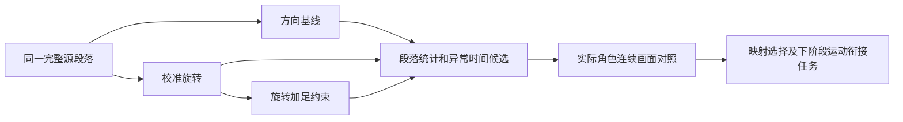

# Stage 16 完整段落的身体保真与约束评估

## 1 本次做什么

黑板E2/E5的可观测性：将单帧映射对照扩展为完整时间段，分别统计方向/旋转参考残差、关节与根运动连续性、足约束的改写量。三个固定对照：direction无约束、rotation无约束、rotation有约束；均rest混合1、physics关闭、同一源时间与根策略。

图名：完整段落多条件评估｜图型：对照实验数据流。

Example：examples/stage-16-sequence-assessment/user_code/main.mjs。API：assessReplaySegment(experiment,{start,end,frameTime,variants,signal,onProgress})；指标聚合器createSequenceAssessment().push(evaluateResult).finish()。
断点：固定采样时刻、push计算相邻帧速度和断流、约束最大改写与时间候选、实际人物视频。
验收：q/-q无假跳、恒定运动与真实跳变区分、缺帧不跨越求速度、同输入统计可复现、取消不留下后台任务；原生实际模型连续段落与UI可用。

## 2 结果和验证

已实现可取消的三条件连续区间评估和最终层残差；没有自动切换日常映射或添加约束。

- 源采样修复：skeletonAt在精确frame*frameTime回读时受浮点误差影响，本机1901帧有30处读到前一帧。加入1e-8帧的极小索引容差，错索引降为0；真正早于边界的时间仍留前帧。四种帧时长的逐帧roundtrip测试覆盖。证据sequence-frame-sampling.json。
- 原生9–18秒源连续区间：方向/旋转height各271帧@30fps；旋转source 136帧@15fps，678张逐帧UI帧号全部验证。视频无音频，未标音乐乐句；包含末端保持帧。完整视频只保存在主工作区work/stage16-sequence-assessment。
- 实际VRM三条件UI评估各270帧，无采样缺口、无renderer错误；评估前后time/mode/rootMode/checkbox一致。最终层残差与约束前残差分别可见。
- source根策略下，最终方向/校准朝向P95：方向基线约0°/106.14°；校准旋转约0°/0°；旋转加足约束约21.37°/16.18°。后者最大方向/朝向偏差约40.39°，出现在10.566656秒左小腿。这里是对校准参考的数值保真，不是美学或人体绝对姿态评分。
- 连续帧表可追踪转身和抬腿回收，校准旋转显著改变高举臂时的袖口/掌朝向；宽袖/发遮挡妨碍皮肤细节判断，没有据此宣称整体更自然、消除脚滑或通过音乐同步。
- 首次捕获发现合成器旧帧和range毫秒量化影响，弃用该视频；修正后逐张核验源帧号。最终合规范围与原生汇总见sequence-native.json。

结论：保留旋转变化和正确时间采样有独立价值；现行足约束会显著改写完整源运动。不能将新映射与旧约束直接打包作为自然舞蹈方案。

## 3 资源和调整

复用本机研究BVH、当前VRM和分层回放。实际研究视频/派生姿态留本机，不随源码/app分发；仓库仅留聚合指标和可发布截图。未引入新音乐算法、训练权重或角色资源。

## 4 进一步评估和计划

下一阶段转E3/E4：建立独立于具体VRM的源动作材料，保留源时间、根轨迹/朝向、有向速度和未知音乐锚点；接触区分plant/slide/lift/flight/unknown。当前两拍RLR筛选丢弃了准备/恢复/转身上下文，提前.3拍混到静态首帧也不保证速度连续；混合姿态与沿用的旧接触状态不属于同一运动。身体映射无法补回这些丢失信息。先建立材料和接触计划，再构造双侧运动窗口的过渡并验证速度/接触。跨真实体型与舞蹈观感评审仍需单独验证。目标持续迭代，未把本阶段仪表通过等同整体音乐舞蹈完成。

最终检查：`npm test` 104/104通过，包含精确帧回读、缺帧窗口、候选合并、最终层残差分离、同段重复评估及取消。构建通过（保留已有Cubism脚本/chunk大小提示）。没有把源视频、派生姿态或角色放入分发包。
