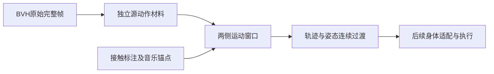

# Stage 17：源动作材料与移动窗口过渡

## 1 本次做什么

依据E3/E4及stage-16：先保存完整源运动，不先重定向或裁成两拍。材料声明单位/坐标、源帧、根轨迹、局部旋转和有向速度；未知舞蹈阶段、接触语义和音乐锚点保持未知。过渡同时采样两段运动，不朝下一段静态首帧减速。当前为研究基线，不自动替换日常播放器。

图名：完整源材料到连续过渡｜图型：数据流｜阶段：stage-17。

Example：`examples/stage-17-source-material/user_code/main.mjs`，先通过公开API构造材料，再采样和评估移动窗口。断点：源帧时间和有向速度、过渡权重、两侧采样时刻、接触声明。验证：全源帧保留、相反转向可区分、恒速轨迹接缝速度、拓扑/非法输入拒绝、本机完整BVH聚合检查。不得输出或分发原始派生姿态。

## 2 结果与验证

实施中，以下仅在命令实际完成后补充。

## 3 资源和调整

复用本地BVH；本轮不需要额外模型、训练数据或DSP。未知接触不能凭脚踝低就宣布plant，未知原曲拍点不能将落脚当音乐拍点。

## 4 进一步评估与下一步

本阶段数值连续性不等于舞蹈自然；尚需根朝向对齐、接触标注、真实VRM回放，以及在同一音乐条件下比较旧/新播放器。源材料通过后再接入研究窗口，避免未经观察直接改变日常默认。

### 已执行结果

- `npm test`：115/115通过，包括有向旋转、q/-q等价、完整1901帧、插值FK弧线、根节点重复表示一致、未知接触和冲突拒绝、不同恒速轨迹的端点速度。
- `npm run build`通过，仅已有Cubism/chunk提示；本阶段模块尚未接入渲染器，所以构建不是实际人物效果验收。
- 原创example及本地完整BVH均运行通过；实际材料1901帧、最后帧时间63.33327秒。调用者显式声明0.01米/源单位，非自动识别。
- 两个不同源窗口9–9.3秒与12.666654–12.966654秒进行0.3秒过渡，共31次内部采样；关节端点角速度数值偏差最大约8.9e-8 rad/s（步长1e-5秒）。这证明端点速度接续的数值条件，不证明中间动作自然、无穿模或可承重。
- 修正了审查发现的两个表示问题：插值位置改为按局部变换FK重建，避免旋转弧线被线性世界位置拉成弦；根节点和joints中重复根同步，避免显式根对齐后数据自相矛盾。
- 证据：`docs/evidence/source-material-native-source.json`仅聚合信息，不包含姿态、BVH或角色；原始数据和派生材料仅运行内存使用。未创建commit（当前目录无Git基线）。

### 明确限制

过渡使用五次权重和短弧slerp，端点条件建立在源窗口本身连续的前提上；插值源帧边界速度仍可改变，不声称整段C2。关节集合检查不等于完整层级兼容验证。任意采样函数的接触冲突只能在实际请求的时刻检查，不能由端点推断全区间兼容。当前只识别planted/flight/unknown兼容性，slide/lift及人工标注还待实现；未知不会自动生成支撑。

下一轮：补接触标注和源窗口来源追踪，接入研究回放，对不同窗口做根朝向/轨迹对齐并观察实际VRM；保留拒绝不兼容后继的路径。达到这些条件后才比较日常音乐播放器的替换。
