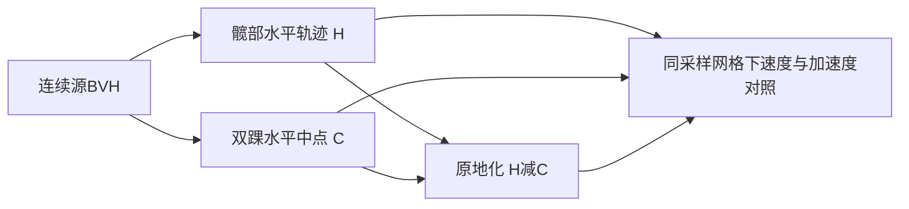

# Stage25 根轨迹与原地化归因

## 1 本轮做什么

Stage24较长运动预备段已降低交接尖峰，但最大根速度仍出现在片段内部。本轮定位源动作与原地化策略的贡献，不继续只调过渡时长。现有balance根使用髋部减双踝水平中点；sourcePoints也减同一中心。socket校正对已执行balance根及完整旋转后的目标髋关节中点做残差补偿，并非简单重复叠加同一平移。

实现纯源坐标评估器及独立可运行example。输入先声明厘米到米，比较原始约30Hz和现有15Hz网格；避免把目标模型缩放、socket、IK、音乐变速及接缝混入同一结论。阶段记录即本地可评审工程任务，未创建外部issue或提交。

## 2 结果、验证与结论

证据 `docs/evidence/root-recentring-source.json`。实际1901帧源BVH；9–48秒连续窗口：

| 网格 | 原髋部水平速度max | 髋部减双踝中点速度max | 原髋部加速度max | 原地化加速度max |
| --- | --- | --- | --- | --- |
| 原始约30Hz | 1.951 m/s | 3.165 m/s | 22.723 m/s² | 44.586 m/s² |
| 编译15Hz | 1.933 m/s | 2.883 m/s | 19.319 m/s² | 32.684 m/s² |

同窗口速度平方精确分解：原始网格mean(|vH|²)=0.355856，mean(|vC|²)=0.827231，mean(−2dot(vH,vC))=−0.517671，合成相对速度平方均值0.665416。原地化根速度RMS增加约36.7%；15Hz增加约34.1%。恒等式数值误差小于5e-15。独立只读分析得到一致结果。

结论：逐帧减双踝中点不只是去除旅行，还会把摆动脚的运动反向带入整个角色的呈现位移。这是确定的数学贡献及实际源材料现象；它是否为实际桌宠观感突移的主要来源，仍需目标链路对照。没有据此宣称根策略应完全删除。

4项专门测试覆盖共同平移抵消、单脚运动引入半速反向位移、常量原点不变性、不等间隔及非法输入。完整181项测试通过（`/tmp/komorebi-stage25-tests.log`）；新增模块不接入应用构建入口，example真实读取本地源文件运行通过。加速度来自有限差分，可能包含源采样噪声，不能当作人体受力测量。9–end窗口独立评估到源末帧；15Hz末尾比prepareLocalDance的floor(duration*fps)编译截断多一个采样，已在example输出限制中标注，不能称为实际动作库帧集合。

## 3 资源和调整

复用本地BVH，无需新增模型、训练或音频。未改变日常或实验播放器默认；没有重新打包应用，因为本轮新增的是离线归因工具。原始数据不在源码包内。

候选调整应把身体所在物理坐标与桌宠窗口的呈现居中分开：先保持身体及双脚在同一一致坐标中，再用低频旅行轨迹控制整体呈现平移。不能单独抹掉根而保持脚目标不动，也不能以冻结身体获得低速度。具体滤波/轨迹拟合方案尚未选定。

## 4 进一步评估与下一步

下一轮在实际模型编译过程中记录balance前、balance后、socket后根轨迹聚合，与当前评估器对齐。明确目标scale、parent世界变换、选段与音乐变速；然后在相同音乐和相同动作计划下对比当前瞬时双踝居中与独立呈现轨迹。检查身体连贯性、脚目标保真、窗口容纳范围及停止恢复，经过完整视觉对照才决定日常替换。
