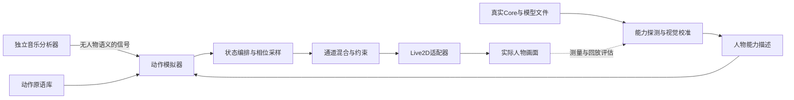

# 动作模拟器：开源参考与组合方案

调研日期：2026-10-28。目标：音乐分析项目只提供信号，动作系统根据人物能力生成、组合和执行动作。本文核对开源源码/官方文档，并做现有人物的参数兼容性检查；没有把上游项目整体运行效果或宣传声明当作本机已验收结果。本轮没有修改运行中的桌宠。

## 结论与需要纠正的边界

建议的核心是“人物能力描述 + 动作原语 + 有状态编排图 + 分层混合/约束 + Live2D适配”。音乐、动作语义、模型参数分别演进。它不是把音乐幅度加到身体参数，也不是一套固定动作反复循环。

现有music-signal-lab中MusicAnalyzer与MusicMotionController放在一起，是首版原型的实现现状。按用户现在明确的边界，后者应迁出，归动作模拟器或桌宠动作模块；音乐分析库最终不应导出headX、arm等运动概念。本轮只记录迁移方向，没有改库接口或新建仓库。

没有查到一个已经验证能“自动读任意MOC3→完整理解身体→按音乐生成自然舞蹈”的可直接接入开源组件。现有项目能分别解决其中几段，组合起来比继续扩展当前正弦摆动器合适。

## 1. 人物分析：优先参考live2d-add-motion-sample-web-ui

项目：https://github.com/shinshin86/live2d-add-motion-sample-web-ui
核对修订：d89d5ee6ccb8eda31220f891f7cc5926d0753acd。MIT。

已读README、tools/analyze_model.py、tools/validate_motions.py及motion-defs/shared/gestures.py。它提供“分析模型→定义曲线→生成motion3→独立校验→浏览器验证”的管线，并有归一化共用动作和参数重映射。

值得复用的机制：

- 标记physics3中的输出，避免动作层与头发、衣物物理争抢参数。
- 从原有motion提取参考范围和基础姿态，并排除自己生成的动作，避免生成结果反过来污染参考范围。
- 共用动作用0表示基础姿态、-1/+1表示参考范围两端，正负方向独立映射，适应非对称默认值。
- 校验关键帧时序、参数范围、贝塞尔中间过冲、循环接缝的值和斜率，以及口型控制冲突。
- 缺参数时跳过或拒绝，提供可解释结果，不通过写一个不存在的ID伪装成功。

边界：analyze_model.py的范围来自已有motion关键帧，未直接读取MOC3真实极限；部分标准参数使用约定范围。我们已有Core探针，应采用“真实参数和硬限 + 原motion舒适范围 + 视觉校准”三者结合。原motion的关键点范围也不自动覆盖整个贝塞尔曲线的极值。

它支持为已存在的绑定设计动作，并不负责给缺失膝盖或手腕的模型补绑定。其示例使用Hiyori Pro，不能因为我们也用日和，就假定Free模型所有通道兼容。

### 当前日和的实际对照

对共享gestures.py的动作定义与当前MOC3的29个真实ID作集合比对：

| 模板 | 请求参数数 | 存在参数数 | 缺失参数 |
| --- | ---: | ---: | --- |
| nod | 7 | 5 | ParamBrowLY、ParamBrowRY |
| shakehead | 7 | 7 | 无 |
| surprised | 10 | 8 | ParamBrowLY、ParamBrowRY |

这三组请求中未发现直接写当前physics输出的通道。结果只证明参数存在性/冲突情况，不证明画面自然，也没有实际播放上游动作。原始对照记录见motion-simulator-compatibility.json。

即使没有同名ID也可能存在可替代的视觉效果，例如眉毛Form与眉毛Y，但两者语义不同，不能自动等同；需要单独的profile映射及视觉确认。能力描述应同时保存证据与置信程度。

## 2. 程序生成：参考AIRI MAGIC的拆包，而非照搬其现成姿势

项目：https://github.com/moeru-ai/airi
核对修订：dfd9453beaab3af43a40f9bdacebdcb0d51f2723。MIT。

重点不是之前已读的beat-sync.ts，而是两个独立包：

- packages/motion-driver-magic：用固定宽度归一化轨迹拟合VAR或AR-HMM模型，按固定采样率及随机种子生成连续运动帧；不导入Vue和渲染对象。
- packages/model-driver-magic-live2d：负责归一化Pose转换、固定频率调度、输出滤波以及target.apply/target.release。宿主提供目标适配器。默认可让生成器不占用mouthOpen，避免覆盖说话口型。

这与我们“运动神经”的边界很接近：生成器产生运动，人物驱动执行运动，应用只组装和调度。

重要限制：读到的现成Live2D Pose为14通道，主要是眼、头、身体、嘴和整体偏移，没有双臂/腿部通道。poseFromValues要求宽度准确匹配。直接接上这个driver仍不会自动得到摆臂舞蹈；通用生成器与现成Live2D姿势桥要分别判断能否复用。

此外，MAGIC需要训练轨迹，不是无需动作样本的音乐舞蹈生成器。其公开GenerateOptions只有noiseScale，不能把它说成已提供拍点条件控制。适合后续从已经验收的动作片段中学习自然变化/过渡，首版不要让它承担舞姿设计和踩拍的全部职责。

## 3. 编排与同步：参考Godot AnimationTree

项目：https://github.com/godotengine/godot ，MIT。
已核对官方stable AnimationTree及AnimationNodeStateMachinePlayback文档，访问日期2026-10-28。

可借鉴的构件：

- StateMachine：决定当前动作状态、可到达的下一个状态和过渡。
- BlendTree：将多个动作节点组合成一个输出。
- OneShot：短手势触发一次，结束后回到底层动作，带进出混合。
- Track filters：只让某层影响一组通道。
- BlendSpace与循环相位同步：根据强度/风格混合相关动作，并保持周期一致。

AnimationTree本身不创建动作素材；它使用AnimationPlayer已有动画。因此，给系统加状态机而没有足够的动作原语，仍然只会在“左摇”和“右摇”间切换。

建议借鉴图和调度机制，在现有TypeScript/Electron宿主内实现轻量版本，不因一个动作系统整体迁移到Godot。Godot可处理任意属性及2D/3D，但其节点和资源并不是可直接放进现有Vue应用的JS库。

## 4. 局部混合：参考ozz-animation

项目：https://github.com/guillaumeblanc/ozz-animation
核对修订：744eb9d99f606eda849acb0b1204f7a3dc20bca1。LICENSE.md明确MIT；GitHub元数据NOASSERTION不能代替实际许可文件。

已读BlendingJob头文件及官方runtime、partial blending、additive blending说明。它将动画采样和姿势混合分开，提供整体权重、逐关节权重、加法层及权重不足时的参考姿势补足。它是低层3D骨骼动画运行库，不是高层动画图，也不负责渲染。

我们借鉴的重点是mask和delta：

- 身体层只控制身体/头部基础姿势。
- 左手手势层只控制左手相关的已映射参数。
- 点头强调作为相对参考姿态的delta叠加，而非再把一份完整中立姿态平均进来。
- 表情/口型保留独立控制权；physics输出不由混合器直接占用。

在Live2D中mask应针对“语义通道→真实参数组”，不能把3D骨骼权重数组原样套到MOC3。任意两个全身姿势作平均可能把抬手幅度冲淡，这也是当前系统需要显式区分override和additive的原因。

## 5. 能力探测与验证工具：参考Rev2D的方法，保留官方Core

项目：https://github.com/RevStudio/Rev2D
核对修订：f144581cdf1f12d781379c4df90d262b8c2dfa3d。MIT。

已读README和src/interop/live2d/model3.ts。可参考“validate→render→参数sweep图→inspect/analyze→修正”的工具工作流。它将参数变化和循环接缝、越界、可见区域等数字证据对应起来，适合设计我们的开发用动作工作台。

关键边界：其Live2D互操作模块明确不读写MOC3，只导入/导出motion3、exp3、physics3、cdi3及部分model3 JSON。自有R2D模型的纯TS无头渲染不能证明当前Live2D MOC3的真实画面。我们应继续使用真实Core和当前渲染器做扫描，不用Rev2D替换它们。

Inochi2D也有参数绑定与物理系统（BSD-2-Clause），但其模型格式和运行时不同。本轮不推荐为复用动作系统而转换已有模型。

## 6. 组合后的系统

图名：开源机制组合后的动作系统｜图型：组件数据流｜阶段：research-03。

这里的动作模拟器是一个边界，G/M是其内部职责，不是先后新增的网络服务。首版可以是同一个TypeScript库，由桌宠宿主调用；开发工作台另开调试入口，桌面日常仍只显示人物。

### 人物能力描述：硬能力和动作语义分开

应记录以下内容：

1. 原始事实：Core真实ID、默认值、上下限，已有motion组，物理输入输出。
2. 视觉探测：按保守范围扫描参数，记录影响区域、方向、响应幅度以及与其他参数的耦合。参数单独有效不证明组合自然。
3. 语义映射：把已确认效果映射为head.turn、body.lean、arm.left.accent等；标记name-hint、runtime-probed或visual-verified，不把名称猜测视为确认。
4. 动作能力：左臂轻摆可用，过顶抬手是否可用另行验证；双手拍掌、迈步、踢腿在当前模型没有证据时明确不支持。
5. 可用范围：用硬范围、舒适范围及组合禁区共同约束。当前模型没有物理意义上的质量、关节力矩和足底接触信息，不能自称已恢复真实人体动力学。

### 动作原语：可参数化的小动作，而非每帧随机数字

建议一个原语至少声明：

- 语义ID、需要的人物能力、作用通道mask。
- 归一化曲线/生成器、时长、强调点、入口和出口姿态。
- 幅度和速度的可调范围，override或additive语义。
- 与哪些原语可叠加，失败时用什么替代，怎样回到可接续姿态。

片段不必每次回到Idle的零点；应通过兼容的连接姿态和过渡保持连续，否则每两拍回正仍会显得机械。motion3导出是审阅/复用格式之一，运行时无需每帧生成文件。

模板是动作的种子。对当前模型，先验收左臂强调、右臂强调、双臂轻张、身体转向配合点头等可达到的效果；若它们的实际视觉变化仍不足以形成舞姿，应补模型绑定或换模型，而不是继续放大整体旋转。

### 编排图：音乐决定运动条件，模拟器负责选择动作

能量选择活动程度，可靠拍点提供同步参考，起音可以触发局部强调。模拟器自己维护当前动作、完成程度、身体状态、冷却和候选动作，按适当的动作边界切换。低置信度不硬跳，静音完成收势。

可用一个“内部8拍动作句”验证编排，以下仅是设计例子：

| 内部拍位 | 身体层 | 手臂层 | 头部/表情层 |
| --- | --- | --- | --- |
| 1–2 | 轻向左转移姿态 | 左臂强调 | 头部稍后跟随 |
| 3–4 | 保持并回中 | 双臂轻张 | 一次点头 |
| 5–6 | 向右侧接续 | 右臂强调 | 反向跟随 |
| 7–8 | 收到可接续姿态 | 轻落手 | 放松后接下一动作句 |

“内部8拍”是编排分组，不声称音乐分析器识别到了真实小节或强拍。以上组合也尚未在当前人物上验收。

MAGIC可作为日后生成自然微变化的后端；明确的舞姿仍先用通过视觉验收的原语。随机生成器和状态机都不能独自保证舞蹈美感。

### 驱动与约束：把神经指令落到这个人物身上

混合器先按通道处理覆盖/叠加，再限制值、速度和必要的加速度，最后交给Live2D适配器。适配器负责真实参数映射、物理前应用以及冲突层的权重交接。现有弹簧保留在最后做衔接，不能用它替代编排。

脚底锚点可用来限制整体漂浮，但不等于实现了足部IK或真实重心平衡。开发工具还要显示当前原语、当前层权重、最终参数、截断原因和回放时间，避免再次出现“信号在动、角色却看不出”的情况。

## 7. 建议的实施顺序

1. 人物能力工作台：输出当前Free模型的真实参数、扫描图、可用动作与不支持列表。验收必须看真实画面，而非仅检查ID。
2. 原语库与独立预览：先做3–5个视觉上明显不同、能独立认出的动作；保留入口/出口和mask。先不接音乐，确认动作本身成立。
3. 无音频的动作图回放：固定输入信号，验证分组控制、接续、局部叠加、静音退出和不越界；与当前单一摆动器做动态对比。
4. 接入独立音乐信号：将能量、起音和可靠拍点作为编排条件。音乐库只输出音乐数据。
5. 再评估MAGIC等生成后端：用已确认轨迹训练自然变体，避免还没有可用舞姿就先训练“更自然地摇摆”。

本轮没有将这些上游组件集成进产品，也没有新建动作模拟器仓库；这是基于源码的组合方案，不是宣布下一版已经具备舞蹈生成能力。

## 证据链接

- AIRI通用生成器：https://github.com/moeru-ai/airi/blob/dfd9453beaab3af43a40f9bdacebdcb0d51f2723/packages/motion-driver-magic/README.md
- AIRI Live2D目标适配：https://github.com/moeru-ai/airi/blob/dfd9453beaab3af43a40f9bdacebdcb0d51f2723/packages/model-driver-magic-live2d/src/driver.ts
- AIRI姿势通道：https://github.com/moeru-ai/airi/blob/dfd9453beaab3af43a40f9bdacebdcb0d51f2723/packages/model-driver-magic-live2d/src/pose.ts
- Live2D动作分析器：https://github.com/shinshin86/live2d-add-motion-sample-web-ui/blob/d89d5ee6ccb8eda31220f891f7cc5926d0753acd/tools/analyze_model.py
- Live2D动作校验器：https://github.com/shinshin86/live2d-add-motion-sample-web-ui/blob/d89d5ee6ccb8eda31220f891f7cc5926d0753acd/tools/validate_motions.py
- Godot AnimationTree：https://docs.godotengine.org/en/stable/tutorials/animation/animation_tree.html
- ozz层权重定义：https://github.com/guillaumeblanc/ozz-animation/blob/744eb9d99f606eda849acb0b1204f7a3dc20bca1/include/ozz/animation/runtime/blending_job.h
- ozz加法混合：https://guillaumeblanc.github.io/ozz-animation/samples/additive/
- ozz许可：https://github.com/guillaumeblanc/ozz-animation/blob/744eb9d99f606eda849acb0b1204f7a3dc20bca1/LICENSE.md
- Rev2D模型互操作边界：https://github.com/RevStudio/Rev2D/blob/f144581cdf1f12d781379c4df90d262b8c2dfa3d/src/interop/live2d/model3.ts
